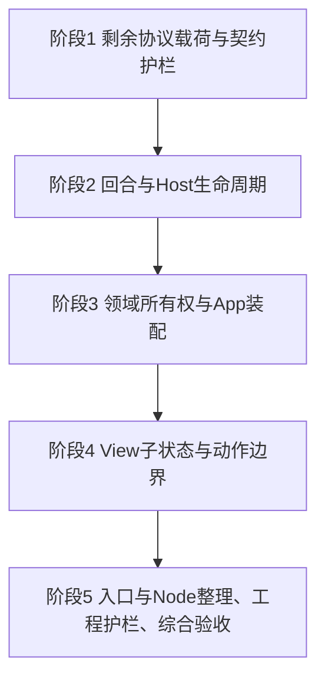

# 后续重构完整实施计划（审阅稿）

> 制定日期：2026-10-26。代码基线：`3d07c0e`。
> 当前状态：已审阅并按阶段实施。阶段 1–3 已完成，阶段 4–5 未开始。
> 本文件覆盖代码审查方案的全部剩余重构，不再每完成一个小批次就重建或删除。整个计划完成后删除本文件及 AGENTS 中的临时入口，完成记录保留在 git 与路线图。

## 一、范围、基线与执行约定

### 1. 范围

本计划承接 `.tmp/code_review.md` 的 P1 剩余项、P2、P3、P4；同时逐项处理其中后置的入口配置、Node 路由、SDK、校验/文本复用与工程护栏。执行细节在本文件中完整列出，不要求其他检出携带被忽略的 `.tmp` 文件。

不把以下产品目标混入重构：delete/fork、timed/continued 提问、运行中 attach、后台多会话交互、RPC 请求级取消、任意命名空间设置、多 provider 凭据、登录、自动更新和新平台支持。这些目标继续由 [路线图](docs/roadmap.md) 与对应设计文档维护；本计划不得删除它们，也不以完成重构代替完成这些功能。

### 2. 已完成基线（不重复实施）

| 提交 | 已交付内容 |
| --- | --- |
| `132f848` | Restart/Runtime 恢复路由快照、单次 launch 身份参数、共享发送门禁 |
| `c427443` | 17 项能力常量与解析值、create/resume 共用能力、双端能力 fixture |
| `3d07c0e` | custom/SDK initialize 具名请求/响应、channel 兼容别名、双端 initialize fixture |

基线已有 `internal/protocol/capabilities.go`、`initialize.go` 和 `tests/fixtures/protocol/`。initialize 的旧 Host 范围回退、空/null/缺失处理与 SDK effort 省略已有回归，不重新设计。

上次检查记录为全量/纯 Go 各 646 项、相关 race 487 项、Node Host 88 项、当批真实 Host 15 项；这是历史基线，不是本次规划执行了这些命令，也不是后续固定测试数量。实际证据以各批提交正文为准。

### 3. 默认实施决策

- 保持当前产品行为、协议版本、能力声明、DSH pin、应用/runtime 分发边界与 Native UI 技术。
- 保留 SDK 显式回归，后续采用适配器隔离；删除 SDK/`cmd/spike` 不属于默认实施动作。
- 先在 `internal/app` 内用明确类型收拢所有权，再按真实依赖决定拆包。文中的组件名是职责草案，不预先承诺创建同名包。
- View 可维护输入、选择、焦点、展开、滚动等 UI 状态；业务转换及 I/O 由应用组件处理。不要求 View 成为完全只读函数。
- 度量/lint 先报告。代码生成、自定义主线程 vet 只做收益评估，通过采用条件才实施，不作为全计划完成的必备技术。
- 不新增 DI/事件总线/Redux 框架，不用字段数、文件行数、零 map、零字面量或零 Sleep 作质量门槛。

### 4. 批次、状态与提交

1. 审阅通过后，按阶段与任务依赖实施；当前不预先开启任何代码批次。
2. 每个编号任务是一项可验证交付；影响范围较大时按文中边界拆成多个连续提交，每个提交都可编译并独立验证。不为凑次数拆提交。
3. 编码/状态重构先固定旧行为；新增行为约束先写能解释失败原因的测试。纯机械搬迁复用已有护栏，不为搬文件编写镜像测试。
4. 阶段状态使用“未开始 / 进行中 / 已完成”；实施时记录当前任务号、实际检查和剩余事项。项目级里程碑/缺口仍只在路线图维护，设计文档不写进度。
5. 任务完成、检查通过后按 D-002 提交，列影响子系统、实现功能、契约变化和实际命令。未通过不提交；中间检查点单独说明。
6. 单任务同一阻塞最多尝试三次；保留证据和最后可运行状态，再处理真正缺失的信息，不靠扩大重写范围绕过失败。

## 二、依赖与优先级



优先执行 1.1 → 1.2 → 1.3，先覆盖导航、发送/取消和恢复的核心路径。阶段 2 必须在对应载荷与时序用例稳定后开始；阶段 3 的组件迁移复用阶段 2 的 Host/回合边界；阶段 4 在业务所有权稳定后移动绑定字段。

阶段 5 的配置解析、同契约工具整理可在前置任务完成后提前单独做，但不能与尚未完成的生命周期迁移混在同一提交。独立读代码/运行检查可并行；这里不引入并行代理或多条互相竞争的实现分支。

风险分级：“低”主要是有明确 oracle 的编码替换；“中”涉及多个调用者或异步结果；“高”涉及事件顺序、持久写入、资源生命周期或 UI 身份。风险级别决定验证深度，不代表已确认缺陷。

## 阶段 1: 完成剩余协议载荷与契约护栏

**目标**: 核心请求、响应、通知信封与错误 kind 有清晰的具名表达，app 不再重复翻译相同 schema。
**成功标准**: 相同 wire 在迁移前后编码语义一致，原有缺失/null/空字符串、必填布尔、安全整数、身份与预算校验保持；未知能力/字段仍按各方法原契约处理，SDK 兼容保持。
**测试**: 每任务的编码/非法载荷表、双端 fixture、相关 Go/Node 单元与 fake/真实 Host；详见第三部分验证分组。
**状态**: 已完成（1.1–1.7）

### 1.1 session/create、session/resume 与摘要（中，已完成）

- **范围/依赖**：基于现有 initialize 类型；涉及 `app.go`、`configuration.go` 的路由构造、`sessions.go`、`session_reader.go` 和对应 Node create/resume/history 测试。
- **实施/交付**：定义创建/恢复请求、具名响应/会话摘要；区分 Host 默认路由与显式 provider/model/effort。先分别固定启动创建、最近会话恢复、Restart、Runtime 切换、普通导航的参数，再迁移各调用者；DTO 与 `view.ModelRoute/SessionSummary` 的转换留在 app。
- **验收/回归**：两种路由不混用；按各方法现有行为分别测试 effort 缺省、空字符串与明确取值，不用统一 omitempty 消除差异；当前持有会话与冷恢复路由规则保持。摘要的 archived、nextSeq、时间、目录和必填空字符串不能因零值而跳过校验。跑初始化、最近草稿恢复、模型设置、会话切换、Runtime 提交/回滚及真实 Restart。
- **完成记录（2026-10-26）**：`internal/protocol/session.go` 增加 create/resume 方法、`SessionRoute` 构造器、请求/响应与摘要 DTO，`tests/fixtures/protocol/session.json` 由 Go/Node 共用。启动创建、冷恢复、普通导航、冷重命名改用具名载荷；create 响应复用完整摘要校验。实际检查：全量/纯 Go 各 672 项、race 564 项、Node 89 项、真实 Host 36 项（含子用例）通过；MyGo vet、Go vet、差异检查通过。剩余：后续任务 1.2–1.7 未开始。

### 1.2 session/prompt、session/cancel 与投递确认（高，已完成）

- **范围/依赖**：依赖 1.1；涉及 `app.go`、`attachments.go`、`local_state.go` 与 SDK `contentBlocks` 分支。
- **实施/交付**：类型化 custom/SDK prompt、现有文本/图片输入块、投递确认与 cancel 结果。实际工具参数、扩展数据仍允许有界 RawMessage/map，不强行统一异构块；每种现有块都有独立编码 oracle。
- **验收/回归**：文本/附件-only、canonical base64、单图/总预算与顺序保持；无效 messageId 不丢草稿。cancel 的必填 cancelled、idle、超时 kind 保持；等待 prompt 被接受之后才取消，提前 idle 不越过取消确认屏障，旧响应不结束新回合。真实附件、取消、流式回归通过。
- **完成记录（2026-10-26）**：`internal/protocol/prompt.go` 增加 custom/SDK prompt、独立文本/图片块、`PromptResult`、取消请求与必填 `cancelled` 结果；`tests/fixtures/protocol/prompt.json` 由 Go/Node 共用。App 发送、附件块与取消确认改用具名载荷，原有投递确认、取消屏障和草稿恢复保持。实际检查：全量/纯 Go 各 690 项、race 582 项、Node 91 项、真实 Host 25 项（含子用例）通过；MyGo vet、Go vet、格式与差异检查通过。剩余：后续任务 1.3–1.7 未开始。

### 1.3 列表、历史、历史窗口与 release（高，已完成）

- **范围/依赖**：依赖 1.1/1.2；涉及 `session_reader.go`、`history_window.go`、`conversation_history.go`、`resync.go`。
- **实施/交付**：分别定义目录分页、旧全量历史、向后窗口、live snapshot、流式 baseline、release 的载荷。共同字段可以复用，方向、cursor、固定 cut、statusRevision 和流版本的上下文校验仍由各读取流程负责。
- **验收/回归**：大 offset、安全整数、空数组与缺失数组、分页固定边界、跨会话/cursor 拒绝、单事件超限、连续 seq 保持；任何一页失败不发布半份投影。保留完整回合补齐、阅读锚点、后台读取无全局禁用、退休句柄释放与冷恢复。覆盖真实大会话、释放后重开及 resync。
- **完成记录（2026-10-26）**：`internal/protocol/history.go` 增加 list/history/release 方法、共享请求/结果信封与方向常量；`tests/fixtures/protocol/history.json` 由 Go/Node 共用。目录、forward、backward、live/stream、resync 与 release 调用点完成迁移，边界校验与原始嵌套载荷保持。实际检查：全量/纯 Go 各 699 项、race 591 项、Node 92 项、真实 Host 24 项（含子用例）通过；MyGo vet、Go vet、格式与差异检查通过。剩余：后续任务 1.4–1.7 未开始。

### 1.4 模型、配置与权限载荷（高，已完成）

- **范围/依赖**：依赖 1.1；涉及 `settings.go`、`configuration.go`、`permissions.go` 和 Node models/configuration/permissions。
- **实施/交付**：按模型目录/选择、默认模型/凭据、权限读写三个小提交迁移；wire 类型不依赖 View 表单类型。凭据写入载荷仅用于传输，不作为 fmt/log/error 参数，诊断只投影白名单状态，不延长 secret 在状态中的寿命。
- **验收/回归**：revision/expectedNextSeq、已提交事件确认、固定字段白名单与失败后不确定屏障保持；空 effort 可清除旧值。持久默认不改当前会话，凭据只写不读，危险权限按实际 sandbox/approval 确认，未协商不调用。真实模型、配置、权限持久化与策略执行通过。
- **完成记录（2026-10-26）**：按模型（`5f791a4`）、配置（`7c56040`）、权限三个连续提交完成。`internal/protocol` 增加 model/configuration/permission 请求与快照 DTO，`tests/fixtures/protocol/{model,configuration,permission}.json` 由 Go/Node 共用；App 读取/写入路径转换到 view 类型，凭据 value 在 RPC 返回后清空。实际检查：全量/纯 Go 各 715 项、race 607 项、Node 95 项、真实 Host 17 项（含子用例）通过；MyGo vet、Go vet、格式与差异检查通过。剩余：后续任务 1.5–1.7 未开始。

### 1.5 审批与用户提问载荷（中，已完成）

- **范围/依赖**：依赖 1.2；涉及 `app/approval.go`、`question.go`、`internal/interaction` 与对应 Host answerer。
- **实施/交付**：类型化回答/取消和通知外层；继续由 interaction 管理 FIFO、身份指纹、表单与载荷校验，不把 UI 可变表单塞进通用协议包。结构迁移不新增 timed/continued 能力。
- **验收/回归**：agentless 提问、审批优先、重复/迟到回答、abort、取消与退出结算保持；错误重试保留表单，关闭不伪造空答案/历史。Go/Node 边界、Tester 和真实审批/提问全部通过，answerer 不悬挂。
- **完成记录（2026-10-26）**：`internal/protocol/interaction.go` 增加 approval/question respond/cancel 参数、问题答案与 closed 外层；interaction 保留队列、指纹、表单和校验，App 发送具名载荷。`tests/fixtures/protocol/interaction.json` 由 Go/Node 共用。实际检查：全量/纯 Go 各 719 项、race 627 项、Node 95 项、真实 Host 24 项（含子用例）通过；MyGo vet、Go vet、格式与差异检查通过。剩余：后续任务 1.6–1.7 未开始。

### 1.6 会话管理与子代理查询载荷（中，已完成）

- **范围/依赖**：依赖 1.1/1.3；涉及 `session_management.go`、`subagent_inspection.go`、`subagents.go`。
- **实施/交付**：分别迁移 rename/archive 与 subagent list/history/status；保留两类地址的不同校验范围，父子关联与展示白名单独立校验。
- **验收/回归**：重命名以提交事实确认；归档当前会话后的恢复/草稿保持。子查询只读直接子任务，fork 继承前缀、reasoning 隐藏、页预算、父预占与句柄释放保持；不得恢复或 prompt 子 Agent。真实会话管理和冷恢复子代理详情通过。
- **完成记录（2026-10-26）**：`internal/protocol/management.go` 与 `subagent.go` 增加 rename/archive、subagent list/history 请求/结果信封、实时状态载荷及模式/状态/结束原因常量；`tests/fixtures/protocol/management.json` 由 Go/Node 共用。App 管理写入、子代理目录/历史和通知改用具名载荷；会话 id 校验、提交事实确认、直接父子关联、展示白名单、fork 前缀、页预算与观察句柄释放保持，不恢复或 prompt 子 Agent。实际检查：全量/纯 Go 各 727 项、protocol/interaction/channel/projection/app/view race 635 项、Node 95 项、真实 Host 4 项（含子用例）通过；MyGo vet、Go vet、格式与差异检查通过。剩余：后续任务 1.7 未开始。

### 1.7 通知信封、方法名与错误 kind 收口（中，已完成）

- **范围/依赖**：依赖 1.1–1.6；涉及 `handleNotification`、`stream.go`、`resync.go`、`crash.go` 与协议常量。
- **实施/交付**：集中已实现方法、通知和已消费错误 kind；类型化 event/status/stream 外层，嵌套持久事件与流帧继续交给 projection 的现有专用解码器。逐个调用点替换，不为未来未实现能力生成假 handler。
- **验收/回归**：未知字段/事件与非法帧的不同处理保持；SDK 点分通知只经显式模式转换。所有入站路径仍有大小、类型、身份与序列校验，错误不泄露秘密。Go/Node fixture、旧 Host/SDK、projection/app 全链路通过。
- **完成记录（2026-10-26）**：`internal/protocol/methods.go|notifications.go|errors.go` 集中全部已实现方法、通知名称与 app 消费的三个错误 kind；`tests/fixtures/protocol/notifications.json` 由 Go/Node 共用。`handleNotification`、流式、会话切换/resync 缓冲与回答错误分支改用常量；event/status/stream 外层具名化，projection 的 event/stream 解码继续处理嵌套载荷，事件 seq 的缺失与零值仍可区分。SDK 点分名称只在显式模式接受，自定义通道继续拒绝。实际检查：全量/纯 Go 各 729 项、protocol/projection/app/channel/interaction/view race 637 项、Node 96 项、真实 Host 43 项（含子用例）通过；MyGo vet、Go vet、格式与差异检查通过。

## 阶段 2: 明确回合与 Host 生命周期

**目标**: 将回合转换、Host 一代资源、异步结果有效性与故障处理建立成可测试边界。
**成功标准**: worker 不读取可变 UI 状态；旧 Host 的已排队通知、失败和关闭不会作用于新 Host；取消与 resync 的既有屏障不丢失。
**测试**: 受控 RPC/队列屏障、表驱动事件序列、Host 进程回收、race、真实 Restart/resync/取消与退出。
**状态**: 已完成（2.1–2.5）

### 2.1 回合与生命周期时序基线（中，已完成）

- **范围/依赖**：依赖 1.2/1.3/1.7；梳理 `awaitingTurn/sawActivity/cancelIdle/promptID/promptDone`、Phase、CancelPending 和 resync 的转换。
- **实施/交付**：形成事件/状态/副作用表，补足当前测试缺口；枚举提交、活动、idle、取消确认、失败、换会话、resync、Host 换代。先区分同代展示清空与新 Agent 版本重建。
- **验收/回归**：覆盖 idle 早于 claim、取消等投递、idle 早于 cancel 响应、取消超时后迟到 idle、旧投递失败、resync 中取消确认；测试不能通过并发调用仅允许主线程的 setter 制造假 race。
- **完成记录（2026-10-26）**：在 `docs/subsystem/session-projection.md` 固化回合生命周期事件/状态/副作用表，覆盖提交、认领、idle、取消确认、初始化/换会话、Restart、失败与 resync；补 prompt 投递失败恢复草稿用例。既有 idle/cancel/resync 屏障测试保持。实际检查：`go test ./internal/app -run TestPromptDeliveryFailureRestoresDraftAndClearsTurn` 通过。

### 2.2 提取回合转换组件（高，已完成）

- **范围/依赖**：依赖 2.1；先在 app 内定义无 UI/I/O 的回合类型，证据充分后再决定是否单独拆包。
- **实施/交付**：显式表达提交、运行、取消确认等状态及事件，返回由 app 执行的清理/刷新意图。prompt 身份与投递完成屏障继续保留；生命周期 Phase 不强行合成同一个枚举。
- **验收/回归**：同一事件序列得到相同终态与副作用；Send/Cancel 不绕过共享门禁。各 reset 按“新 Host/换会话/失败/同代 resync”有明确语义；原回合、流式、草稿和真实取消测试保持。
- **完成记录（2026-10-26）**：新增 `internal/app/turn.go` 的纯 `turnTracker`，持有 awaiting/activity/cancelIdle/promptID/delivery，显式提供提交、活动、idle 认领、取消开始/idle/完成/超时、reset、恢复与失败转换；App 保留 Phase、代理队列与投影副作用。初始化、换会话、Restart 统一走 reset；resync 快照恢复活动状态；投递/取消回调继续按 prompt 身份失效。实际检查：`go test ./internal/app` 253 项、`go test ./...` 732 项通过。

### 2.3 封装一代 Host 资源与关闭目标（高，已完成）

- **范围/依赖**：依赖 2.1，可与 2.2 分提交；涉及 startHost/stopHost/watchHost、client、supervisor、通知入口及 Runtime 切换。
- **实施/交付**：用一代 Host 的资源对象持有 client、supervisor、身份、generation 与关闭状态；对特定对象关闭，不在异步执行时重新获取“当前 Host”。启动、初始化失败和正常退出分别有回收边界。
- **验收/回归**：旧 watcher、读循环错误、慢 stop 和重复 Close 不关闭或覆盖新 Host；启动中退出、失败候选/回滚、排队旧事件、UI 背压停止与进程树回收都有用例。保持 stdout 纯净、stderr 有界和 Windows Job Object 行为。
- **完成记录（2026-10-26）**：新增 `internal/app/host.go` 的不可复用 Host 实例，持有 client/supervisor/generation/closed 与幂等 stop；App 改为 currentHost/installHost/detachHost/stopHostInstance，通知入口、读循环、watcher、初始化发布与失败发布都绑定捕获实例。Restart 与 Runtime 切换先 detach 再异步停止旧实例；关闭后的实例仅保留只读 PID/stderr 诊断。实际检查：`go test ./internal/app` 256 项、`go test ./...` 735 项通过；新增旧通知/旧失败/重复 stop/关闭后安装用例。

### 2.4 按语义收拢异步 operation/cancel（高，已完成）

- **范围/依赖**：依赖 2.3；逐项核查 session/settings/runtime/inspection/workspace/mention，而非统一替换七处。
- **实施/交付**：先抽完全相同的版本令牌/取消基础；每个领域继续持有会话、Host、路径或子任务身份。读取、持久写入、Runtime 事务、工作区多路并行使用不同策略。
- **验收/回归**：旧结果在取消、换会话/目录、Host 换代、关闭面板后失效；写入超时仍保留不确定状态，不能因为丢弃响应就允许下一次写入。相互独立的工作区目录读取不被一个全局 Slot 错误串行化/取消。
- **完成记录（2026-10-26）**：新增 `internal/app/operation.go` 的 operationSlot（版本 id + 取消），用于会话、设置和子代理读取；每个领域继续独立校验 session id、Host generation、父/子身份、路径或目录。Runtime 保留 generation/cancel 事务，工作区保留 generation、preview/diff 请求号与按路径加载状态。实际检查：`go test ./internal/app` 257 项、`go test ./...` 737 项通过；新增 slot 失效/取消与独立目录读取用例。

### 2.5 通知路由、故障与诊断边界（高，已完成）

- **范围/依赖**：依赖 1.7、2.2–2.4；涉及 `stream.go` 的有界批次、`handleNotification`、`setFailure` 和 `crash.go`。
- **实施/交付**：先保留原队列顺序，再按通知类型拆 handler；Host 相关消息在发布时校验所属代，RPC 回调与通知仍经过同一有序提交边界。本机保存/设备偏好回调按各自生命周期判定，不能随 Host 换代全部丢弃。failure helper 显式携带目标 Host；诊断组件拥有 logger/文件/锁与脱敏策略。
- **验收/回归**：seq 去重、缺口、状态 revision、resync 缓冲与 batch 单次投影发布保持；通知与回调不能因新 dispatcher 重排。第一次故障原因不被迟到失败覆盖，自定义模式不展示原始 stderr，SDK 有界诊断兼容，秘密不进入日志/报告。
- **完成记录（2026-10-26）**：`hostNotification` 携带来源 Host 实例，`processNotification` 作为通知/RPC 回调和本机回调的统一有序提交边界；event/status handler 单独拆出。`failHost` 绑定目标 Host，首次失败保持。日志、文件、锁、崩溃报告捕获与 secret 脱敏集中到 `diagnostics`，App 仅构造已定界报告。实际检查：`go test ./internal/app` 260 项、`go test ./...` 737 项通过；新增旧代状态丢弃/本机回调保留、首次失败不被覆盖用例。

## 阶段 3: 收拢领域所有权并缩小 App 装配职责

**目标**: 各领域拥有自己的状态、操作与生命周期方法，App 负责明确的跨领域协调。
**成功标准**: 状态所有者与线程归属可由类型/方法边界理解；不靠任意文件直接写全部字段；初始化/恢复发布顺序和退出屏障清晰。
**测试**: 每迁移一个领域跑对应 fake/真实 Host、迟到结果/取消与草稿隔离；资源领域补 race 和释放验证。
**状态**: 已完成

### 3.1 设置组件：模型、配置、权限与 UI 偏好（中，已完成）

- **范围/依赖**：依赖阶段 1、2.4；来源 `settings.go`、`configuration.go`、`permissions.go`、`ui_preferences.go`。
- **实施/交付**：将读写操作、待确认状态和会话选择收归明确组件；设备级偏好与 Host 设置分开。提供刷新/应用/取消/HostChanged 入口，通过快照或窄适配发布 View 数据。
- **验收/回归**：模型与权限能力互不依赖，默认与当前路由不混淆；失败屏障、secret 清空/控件换 key、偏好保存失败和 locale 启动快照保持。测试覆盖切换/重启期间迟到写入与读取。
- **完成记录（2026-10-26）**：新增 `settingsComponent`，拥有 settings operation 令牌与目标会话；`begin/current/invalidate/hostChanged` 成为唯一入口，App 在 HostReady 时使旧读写失效。模型、配置、权限继续按能力独立读取/写入并发布到 View 快照；凭据清空、失败屏障与设备偏好存储不变。实际检查：`go test ./internal/app` 261 项通过；新增目标会话/换代失效用例。

### 3.2 会话导航、目录与元数据组件（高，已完成）

- **范围/依赖**：依赖 1.1/1.3/1.6、2.3/2.4；来源 `sessions.go`、`session_management.go`、目录读取逻辑。
- **实施/交付**：分清 Navigator、Catalog、元数据写入的所有者；目录刷新不能取得全局导航/输入门禁。切换在完整历史/权限快照有效后一次提交，退休句柄由所属组件管理。
- **验收/回归**：搜索/归档过滤、重命名确认、切换失败保留旧投影、迟到目标通知隔离、草稿切回和 release 后冷恢复保持；不会累计无限 Agent 或把目录缓存当日志真相。
- **完成记录（2026-10-26）**：新增 `sessionNavigator`（操作令牌、加载目标、有界通知缓冲）与 `sessionCatalog`（标题/dirty/历史需求/退休句柄）并嵌入 App；目录刷新改用 `Refreshing`，不再占用 `SessionBusy` 全局门禁；切换/元数据写入复用 Navigator 令牌并在完整历史/权限快照后一次提交。实际检查：`go test ./internal/app` 263 项通过；新增缓冲预算、失效与 catalog 换代用例。

### 3.3 历史窗口、流式与 resync 组件（高，已完成）

- **范围/依赖**：依赖 3.2、2.2/2.5；来源 `history_window.go`、`conversation_history.go`、`resync.go` 及投影发布接口。
- **实施/交付**：窗口拥有读取边界/锚点；resync 拥有固定 cut、缓冲与重试预算；projection 仍负责纯事件投影。以明确的恢复结果整体提交，和 Navigator 约定切换、取消及 release 的先后关系。
- **验收/回归**：完整回合前插、布局提交后的触顶检测、尾部返回、历史/实时去重、已提交预览清理及 reasoning baseline 保持；同代恢复不清版本高水位，新 Agent 才重建。真实缺帧与大会话读取通过。
- **完成记录（2026-10-26）**：新增 `historyComponent`，拥有 resync 固定 cut、状态 revision/host status 与历史/流 baseline 能力；start/cancel/commit 都经组件，宿主换代显式重置，快照提交不降低同代高水位。窗口读取边界/锚点与 projection 仍由既有 flow/纯投影负责。实际检查：`go test ./internal/app` 265 项通过；新增 cut 取消、换代重置与 revision 单调用例。

### 3.4 本机编辑状态、草稿与退出协调（高，已完成）

- **范围/依赖**：依赖 3.2、2.3；来源 `local_state.go` 与 preferences writer，保留 preferences 存储公开行为。
- **实施/交付**：组件拥有按会话草稿、投递待确认快照、加载/冲突/保存状态；独立退出协调器先捕获最后 UI 编辑，再 flush、关闭资源、退出。领域组件通过明确结果参与，不在 View build 中启动退出工作。
- **验收/回归**：确认前不丢原稿，新编辑不被旧响应覆盖；恢复失败仍可找回旧草稿。预算、冲突、加载失败时保留窗口，显式放弃才绕过保存；Host、writer 和终端只释放一次，关闭流程可重试。
- **完成记录（2026-10-26）**：新增 `localComponent` 拥有按会话草稿与 preferences writer，`quitCoordinator` 负责单飞/失败可重试/完成状态；RequestQuit 先捕获编辑再 flush、Shutdown 和调用退出回调，ViewModel 仍只读展示。实际检查：`go test ./internal/app` 267 项通过；新增草稿隔离与退出重试用例。

### 3.5 Runtime 引导、切换与 first-use 协调（高，已完成）

- **范围/依赖**：依赖 3.1/3.2/3.4、2.3；来源 `runtime.go`、`first_use.go`。
- **实施/交付**：引导与管理状态归 Runtime flow；运行时安装/下载能力仍由 runtimes.Manager 提供。切换显式表示准备、停止、候选初始化、提交、失败回滚；first-use 通过窄接口请求会话/凭据操作。
- **验收/回归**：候选初始化成功前不提交设备选择，失败恢复旧 profile/Host/会话及模型快照；首启无旧选择时回引导。取消、关窗、设置模态、工作目录确认与草稿保留保持；external 移除只遗忘条目，不删用户文件。
- **完成记录（2026-10-26）**：新增 `runtimeComponent`，拥有运行时检测/安装代际、取消与唯一 pending switch；切换事务显式标记准备、停止、候选初始化、提交、回滚，候选 initialize 成功后才 `Select` 设备选择。download/install 能力仍留在 `runtimes.Manager`；首启 UI 继续只持有 ChooseFolder/UseFolder/Connect 三个窄回调。既有切换提交/回滚、首启引导、外置条目移除与草稿保留测试通过。实际检查：`go test ./internal/app` 268 项、`go vet` 与 gofmt 通过。

### 3.6 子代理展示与只读检查组件（中，已完成）

- **范围/依赖**：依赖 1.6、2.4/2.5；来源 `subagents.go`、`subagent_inspection.go`。
- **实施/交付**：区分实时摘要与持久详情页，拥有读取令牌、父子身份、选中任务与分页；生命周期入口包括 Close、ParentChanged、HostChanged。
- **验收/回归**：关闭/切换后旧详情不复活，审批/提问保持优先，不影响主会话草稿、流或 nextSeq；只保留一页、不订阅子 token 流、不恢复子 Agent，冷父会话查询仍有效。
- **完成记录（2026-10-26）**：新增 `subagentComponent`，实时摘要与只读详情分离；组件拥有读取令牌、父会话 provider、选中子任务与单页游标，Close/父会话变化/Host 变化统一取消读取并清理身份。详情读取绑定打开时的父/子、Host 代际与读取令牌，分页校验继承前缀；外部/未知 mode 不读历史。实际检查：`go test ./internal/app` 269 项；新增跨父通知、关闭后迟到详情、分页前缀用例。

### 3.7 工作区文件、Git、预览与终端资源（高，已完成）

- **范围/依赖**：依赖 2.3/2.4、3.4；来源 `app/workspace.go` 与 `internal/workspace`，保留根目录约束与只读行为。
- **实施/交付**：拆分项目级生命周期与独立 preview/diff/tree/terminal 工作；共享资源组拥有取消和终端句柄，允许同项目必要的并行读取。隐藏面板与真正销毁资源分开。
- **验收/回归**：路径/符号链接越界与输出预算保持；换目录丢弃旧文件/图片/Git 结果；隐藏保留终端，项目切换/退出回收 PTY。用显式原生终端 smoke 检查真实 shell 回合、关闭与进程残留，普通测试不触发依赖下载。
- **完成记录（2026-10-26）**：新增 `workspaceComponent`，项目代际/读取上下文、preview/diff/terminal 请求令牌与终端句柄组分离；换目录显式 `switchProject` 取消读取并销毁终端，隐藏面板只改 View。目录读取继续独立并行，单点失败不影响其他目录；终端启动期间项目切换或退出会关闭新句柄。实际检查：`go test ./internal/app` 270 项；原生终端 smoke（`DSH_MYGO_NATIVE_TERMINAL=1`）本轮未运行。

### 3.8 附件、预览与路径补全组件（中，已完成）

- **范围/依赖**：依赖 1.2、2.4、3.2/3.7；来源 `attachments.go`、`mentions.go`，继续使用 attachment 的预算/媒体规则。
- **实施/交付**：组件拥有暂存、预览身份与会话边界；加载使用会话/目录/附件身份快照。补全和大文件读取留在 worker，输入/粘贴/拖放只发明确动作。
- **验收/回归**：移除后迟到预览不复活，换会话不带走暂存；图片像素/字节预算、附件-only、粘贴/拖放/选择器和补全键盘行为保持。附件内容不写草稿文件、日志或崩溃报告。
- **完成记录（2026-10-26）**：新增 `attachmentComponent`，拥有协商策略、暂存预算校验、预览身份与补全代际；预览/提及/文件读取使用会话快照，会话切换清空暂存，选择器在切换后丢弃结果。附件字节仍只存在于未发送草稿，不写 preferences、日志或崩溃报告；已有移除/清除/换会话预览隔离测试继续通过。实际检查：`go test ./internal/app` 271 项；新增暂存预算、预览/提及会话边界与切换清空暂存用例。

### 3.9 App 装配、跨领域发布与设计收口（中，已完成）

- **范围/依赖**：依赖 3.1–3.8；不预设 App 的字段/方法数量目标。
- **实施/交付**：App 保留窗口入口、组件装配与显式路由；写出 HostReady、SessionChanged、ResyncCommitted、RequestQuit 的协调顺序。能证明独立的 reset 才下放，不能用一组无序 OnHostReady 隐藏依赖。
- **验收/回归**：无循环导入、无“所有组件都持有 App 指针”的假拆分；跨域最小接口可 fake，状态归属和取消目标可定位。只把实现迫使改变的结构/契约写入设计文档，剩余进度写路线图；全量关键链路验证通过。
- **完成记录（2026-10-26）**：`hostReady`、`sessionChanged`、`resyncCommitted` 成为显式发布入口并固定顺序；`RequestQuit` 保持单飞、保存失败保留窗口、Shutdown 后只完成一次退出。组件的跨域依赖只通过 `sessionOf` provider、显式参数或既有窄回调传入，组件不持有 App。设计文档新增跨领域发布顺序表；测试文档补充组件生命周期覆盖。实际检查：`go test ./...`、`CGO_ENABLED=0 go test ./...`、`go test -race ./...` 各 750 项通过；Node Host 96 项、scripts 10 项通过；`TestAgainstMygoRealComposition` 与 `node scripts/test-real-host.mjs --runtime` 通过；MyGo/Go vet、gofmt、`git diff --check` 通过。原生窗口、安装器与 macOS 本轮未重验。

## 阶段 4: 整理 View 子状态与动作边界

**目标**: ViewModel 按交互区域组合，输入绑定与 UI 身份稳定，展示不拥有 Host 业务转换。
**成功标准**: 不复制持久会话真相；业务门禁与 app 一致；字段移动不丢输入、焦点、滚动或展开状态；没有跨帧保存 Element/Context。
**测试**: Tester 多帧/隐藏返回/焦点/键盘、宽窄最小窗口、Windows 原生输入与截图，必要时真实 Host 回归。
**状态**: 未开始

### 4.1 按区域组合 Model（高）

- **范围/依赖**：依赖阶段 3；来源 `view.go`、sessions/settings/composer/recovery 与现有子状态。
- **实施/交付**：按 Chat、Composer、Sessions、Settings、Recovery 等区域逐个迁移，复用现有 Runtime/Permission/History/Inspection/Workspace 状态。先固定控件 key 和绑定地址，再移动字段，避免整份 Model 替换。
- **验收/回归**：输入法/多行草稿、列表阅读位置、展开与复制反馈、弹层关闭焦点、重复显示控件的状态都保持。Capabilities 与“Ready/Busy/Uncertain”等运行状态分开，不能把协商成功当作可写确认。

### 4.2 分区域动作接口（中）

- **范围/依赖**：依赖 4.1；涉及 app 装配回调和 View 测试 fake。
- **实施/交付**：按 Chat/Session/Settings/Runtime/Workspace 等区域收敛动作；接口或函数结构以实际使用者为准，不建立一个包揽全部回调的大接口。保留可选动作缺席与能力门禁表达。
- **验收/回归**：View 不 import app/channel/host/runtimes；fake 不必实现无关动作。相同按钮、快捷键、菜单和程序入口仍使用相同业务门禁，无外部副作用发生在无条件 render 中。

### 4.3 构建期动作、Markdown 配置与导航顺序（中）

- **范围/依赖**：依赖 4.1/4.2；涉及 View、composer、菜单、Markdown/code block。
- **实施/交付**：区分 MyGo 输入处理/展示状态更新与业务副作用；菜单导航保留构建结束后的提交点。Markdown 主题/回调仅在有明确收益时改为局部配置，持久回调捕获 Services。
- **验收/回归**：当前 MyGo v0.6.2 API 可用，不使用不存在的 c.Memo；不保存帧作用域值。反复构建、隐藏/返回、流式提交、链接/代码复制、切换主题与弹层导航没有额外 I/O、重复动作或身份冲突。

### 4.4 统一自有提示与本地化入口（中，按区域分提交）

- **范围/依赖**：依赖 2.5、3.9、4.2；涉及 `internal/i18n`、app 的系统提示与 View 展示。
- **实施/交付**：先迁移恢复/发送/设置错误，再迁移会话/Runtime/工作区提示；用具名消息 key 与参数表达应用自有文案。技术详情与用户/工具/Host 内容保持独立通道，保留必要英文诊断回退。
- **验收/回归**：改标点不再破坏消息标识，参数在中英文中完整匹配；不翻译用户正文、工具输出、提问选项或模型 ID，不把秘密拼进参数/日志。错误摘要、重试动作与失败屏障不变。

### 4.5 布局函数与语义 token 整理（中）

- **范围/依赖**：依赖 4.1–4.3；来源 sessionPanel/composer/settings/活动卡片及 tokens。
- **实施/交付**：按 header/search/list/row/form 和 attachments/mentions/input/toolbar 等语义拆函数；只有重复且具有设计语义的尺寸进入 tokens，不把每个数值机械命名。
- **验收/回归**：不借重构改变外观或默认交互；消息/活动/输入共享阅读边界，最小窗口操作可达，标题栏系统按钮不被覆盖。Tester 校验真实回调与布局边界，Windows 核对宽/窄/最小客户区及主题/语言。

## 阶段 5: 入口、Node、共用工具与工程验收

**目标**: 收口剩余维护热点，建立可负担的持续护栏，验证完整重构产物。
**成功标准**: CLI/Node/SDK 行为保持；真正相同的工具复用；工程检查可复现；条件性工具建设有明确采用或不采用结论；必要验收完成，剩余产品/平台缺口如实保留。
**测试**: CLI 表驱动、Node conformance、SDK smoke、边界工具用例、CI/依赖检查、最终全量与真实组合/Windows/本地打包检查。
**状态**: 未开始

### 5.1 入口配置解析（中）

- **范围/依赖**：依赖 1.1、3.5；来源 `main.go` 与已有 `main_test.go`。
- **实施/交付**：分离 flag 解析/模式解析与窗口创建，明确 host-command、source、runtime-dir、设备 runtime 与 SDK 的优先级；必要时使用小枚举表达 LaunchMode。
- **验收/回归**：保留显式空 `-effort` 对 Host 默认的覆盖、重复 host-arg、非法 profile/session 组合、DSH_HOME、cwd、开发/安装版目录默认和启动错误。窗口建立前不发布 UI，main 不承担慢 I/O/进程等待。

### 5.2 Node server 路由与 session handlers（高）

- **范围/依赖**：依赖阶段 1、2.5；来源 `resources/host/server.mjs`、`channel.mjs`，保留现有领域模块。
- **实施/交付**：先把现有分派与门禁写成顺序明确的表/小函数，再按 create/resume/prompt/cancel 生命周期提取 handler；不引入通用中间件框架，不修改 DSH core 或行 id。
- **验收/回归**：shutdown 在 initialize 前可用，stopping、initialize、配置 pending、权限不确定、capability 和所属会话检查的先后不变，错误 code/kind 不变。退出先同步 abort 再等待排空，迟到句柄仍释放；Node 全量、真实 Loader/stdout/退出及 managed runtime smoke 通过。

### 5.3 SDK 显式适配器隔离（中）

- **范围/依赖**：依赖 2.3/2.5、5.1；来源 SDKProtocol 分支、SDK fixture 与 `cmd/spike`。
- **实施/交付**：默认保留，将点分通知、contentBlocks、初始化形态与不支持能力封装到明确适配边界。协议选择留在组合根；无需为追求零分支制造假能力或复杂统一接口。
- **验收/回归**：custom 不自动降级，SDK 不能出现 stream/审批/提问/历史/设置等假能力；旧 fake SDK/启动与 spike 编译回归保持。删除 SDK 必须是新的明确范围变更，不能借本计划默认执行。

### 5.4 同契约校验与文本工具复用（中）

- **范围/依赖**：依赖阶段 1 的编码/校验基线；核查 channel/interaction/preferences/app 的 ID 和 projection/view/app 的文本工具。
- **实施/交付**：仅复用相同字符串 ID 基础规则；RPC ID 的字符串/安全整数规则留独立入口。messageId 增加语义入口时先沿用既有接受范围。文本工具按字节/rune、头/尾、原始空白/摘要、是否加省略号/返回截断标记区分。
- **验收/回归**：Unicode、边界长度、控制字符、负/零预算、精确上限与大字符串保留行为不变；不能把字节预算改成 rune 或改变复制源文。没有净收益的薄包装保留原位并记录原因，不强造 textutil/validation 大杂烩包。

### 5.5 度量、依赖与 CI 护栏（中）

- **范围/依赖**：依赖前三阶段可稳定识别的所有权；来源 scripts、Go 工具和 `.github/workflows/ci.yml`。
- **实施/交付**：保存可复现的 AST 度量口径，报告函数/字段趋势；增加有价值的依赖方向与生成物检查。评估新增代码 lint，先报告基线，再仅为明确适用的规则启用阻断；已有 lint/vet 能解决的事情不另造规则。
- **验收/回归**：测量能复跑，不统计生成拷贝/测试为生产热点；不把 UI 声明式长度当失败。CI 保留 Windows/Linux 检查，新增 race/真实 mock Host job 前明确 CGO 工具链、精确 DSH 来源、隔离路径和超时；mock job 无付费模型/用户配置依赖。无合适 runner 的原生/打包验收继续列明平台门槛。

### 5.6 代码生成与自定义主线程检查的采用评估（评估必做，实施有条件）

- **范围/依赖**：依赖阶段 1、2、5.5；这项交付首先是一份简短决策记录，而不是必须创建生成器和 analyzer。
- **采用条件/交付**：只有 fixture 后仍反复出现双端词汇漂移、且生成范围/维护成本可界定，才生成常量等明确产物；说明 schema 覆盖范围，新增行为仍修改 handler/校验/测试。只有现有 MyGo vet 与边界类型无法覆盖的真实线程问题足够明确，才做小范围 analyzer 或可验证的线程断言。
- **验收/回归**：采用则生成确定、双端消费、校验无差异且不产生循环导入；检查器有正/反例及可接受误报率，不依赖解析 runtime.Stack 等脆弱 goroutine 技巧。不采用则记录证据、保留 fixture/vet/快照护栏，这项评估也可完成。

### 5.7 综合验收、兼容矩阵与计划关闭（高）

- **范围/依赖**：所有必做任务完成，5.6 有明确决策；不把未做的新产品功能算成失败或完成。
- **实施/交付**：整理最终所有权/依赖图、实际支持的 app/Host/runtime 组合与检查记录；清除过渡字段、失效 helper 和不再需要的兼容别名，但保留仍有调用者的入口。补充 DSH 升级检查清单，实际依赖升级仍另立任务。
- **验收/回归**：完成第三部分适用检查；应用本体与选中 runtime 身份/范围匹配，首启与连续启动恢复正常，退出无残留进程。Node/Host 资源变化后本机构建与 packaged smoke 通过；不上传 Release、不运行安装器覆盖用户安装、不修改系统证书信任。
- **关闭条件**：审查热点有明确所有者/契约或不采用理由；无已知未处理回归，所有未验证平台与发布缺口保留在路线图；最后提交实际结果，再删除本文件及临时路由。干净 VM、macOS 或付费模型未执行时明确列缺口，不把它们写成已通过。

## 三、测试与验收执行清单

### 1. 每批检查与阶段门

| 检查组 | 执行时机 | 必须证明什么 |
| --- | --- | --- |
| 定向 Go/fixture | 每个协议或状态任务 | 新行为有红/绿证据，机械迁移有旧行为 oracle，含非法载荷/空值/迟到结果 |
| 受影响包完整测试 | 每个实现提交前 | 相关子系统原有回归没有被选择性略过 |
| Go 全量、纯 Go、vet | 阶段门和最终代码版本 | 全仓库构建/测试一致；MyGo 身份/存储值约束未破坏 |
| race | 生命周期/共享状态改动及阶段门 | 对受影响包执行，必要时全仓库；不将绿色结果解释成所有时序安全 |
| Node 全量 | 协议/Host handler/fixture 改动 | 方法门禁、answerer、序列、预算、关闭与错误隔离 |
| 真实 mock Host | 协议/生命周期/跨领域提交 | 实际 Loader/Agent/日志/持久化可用，PASS 而非 SKIP |
| Tester + Windows 原生 | View/输入/焦点/布局改动 | 可操作、跨帧稳定、系统标题栏和客户区内可达 |
| PTY/工作区 | 终端/目录生命周期改动 | 真实进程和句柄释放、越界拒绝、只读和并行读取 |
| 本地打包 smoke | Host 资源/布局/启动或发布资源改动及收口 | app-only 与独立 runtime 的可用组合，非“存在一个 exe” |
| 文档/差异 | 每个提交 | 新路径/链接有效，设计/进度职责分离，提交符合 D-002 |

同一代码版本的检查已通过就复用证据；后续改变影响相应检查时再运行。不为增加绿色次数重复跑耗时检查。

### 2. 基础命令（计划执行，非本轮已执行）

```powershell
go build ./...
go test ./...
go vet ./...
go tool mygo vet .
go test -race ./internal/protocol ./internal/channel ./internal/projection ./internal/app ./internal/view
node --test "resources/host/tests/*.test.mjs"
git diff --check
```

纯 Go 检查在独立命令进程中执行 `$env:CGO_ENABLED='0'; go test ./...`，不污染后续 race 的环境；race 使用支持 CGO 的工具链。改动 host/workspace/interaction/preferences 等包时，把对应包加入 race 范围。

### 3. 真实 Host 场景白名单

测试进程只选择一个 source/runtime 入口：source 使用 `DSH_MYGO_DSH_DIR=D:/Workspace/deepseek-harness`，managed 使用实际构建的 `DSH_MYGO_RUNTIME_DIR`。其余入口变量清空，所有 profile、DSH_HOME、UI 状态、端口与临时目录隔离。

| 场景 | 优先复用的现有测试 |
| --- | --- |
| Loader/握手/stdout/退出 | `TestAgainstMygoRealComposition`、`TestMygoRealProtocolLifecycle` |
| 崩溃、模型快照、流版本重置 | `TestAgainstMygoRestart` |
| 发送、取消、流式 | `TestAgainstMygoRealCancellation`、`TestAgainstMygoRealStreaming` |
| 审批/提问 | `TestAgainstMygoRealApprovals`、`TestAgainstMygoQuestions` |
| 导航/重命名/归档 | `TestAgainstMygoSessionSwitching`、`TestAgainstMygoSessionManagement` |
| 窗口历史/释放/完整回合 | `TestAgainstMygoLargeHistoryAndReleasedSessions`、`TestAgainstMygoCompleteTurnHistory` |
| 历史持久化与重新启动 | `TestMygoRealHistoryAfterRestart` |
| 持久/流式补齐 | `TestAgainstMygoResync` |
| 模型/默认/凭据/权限 | `TestAgainstMygoModelSettings`、`TestAgainstMygoConfiguration`、`TestAgainstMygoPermissions`、`TestAgainstMygoPermissionEnforcement` |
| 附件/工具 diff/子代理 | `TestAgainstMygoRealAttachments`、`TestAgainstMygoToolDiffs`、`TestAgainstMygoRealSubagentStatus` |
| 草稿/首启/profile 升级 | `TestAgainstMygoLocalEditingState`、`TestAgainstMygoFirstUse`、`TestAgainstMygoProfileUpgradeAndSecondStart` |

按任务选取上述白名单，用精确 `-run` 模式、`-v -count=1` 和足够的整体超时，检查每个真实子用例的 PASS。不要用宽泛的全部 `TestAgainst*` 选择替代白名单；本计划不运行需要真实 key 的 `TestAgainstMygoRealModel` / `TestAgainstRealDSH`。

### 4. Windows / PTY / 打包

- Tester 覆盖 Enter/Ctrl+Enter/换行、附件-only、停止、焦点、模态优先级、窗口往返、历史锚点与参数/正文复制；输入法组合/候选和原生快捷键另在 Windows 窗口验收。观察缺失时不得仅凭“找到同名文字”判成功。
- Windows 原生检查使用当前构建和隔离 fake/mock Host；按实际客户区检查宽/窄/最小窗口，操作需验证状态变化。自动化注入失败如实说明，不能把截图检查当作操作通过。
- 终端 smoke 显式设置 `DSH_MYGO_NATIVE_TERMINAL=1` 后运行 `TestNativeTerminalShellRoundTrip` 与 app 的终端隐藏/换项目/退出回归，测试后核对资源释放。
- 本地按 [打包与更新](docs/subsystem/packaging-updates.md) 使用现有构建/校验/smoke；不改生产版本、签名设置或发布状态来掩盖兼容错误。干净机器安装、签名信任与 macOS 验收属于发布环境门槛，缺失时继续列明。

## 四、风险、回退与采用条件

| 风险 | 实施控制 | 失败后的回退边界 |
| --- | --- | --- |
| 类型化改变 null/缺失/空值 | 每种方法先固定旧编码/解码；DTO 与上下文校验分离 | 回退当前方法批次，保留新增行为基线，不连带回退已验证类型 |
| 取消/idle/resync 次序漂移 | 受控屏障与事件序列先行，保持统一提交顺序 | 停止状态机/dispatcher 迁移，回到上一可运行组件边界 |
| 旧 Host 影响新 Host | 代身份在入队和提交处核验；关闭持有明确资源对象 | 回退本代资源改造，不以全局互斥锁包住 UI 来掩盖问题 |
| 写入取消导致状态被误认为确定 | 保留 revision/seq 确认与不确定屏障 | 恢复原写入协调方式，不把刷新当成已撤销远端副作用 |
| 组件拆分只是字段搬家 | 独立所有者/窄接口/可验证生命周期，禁止每个组件持有整个 App | 先留在 app 包内收拢类型，推迟拆包 |
| View 字段移动丢身份 | 固定 key、绑定字段与 ListState/Handle 生命周期，逐区域迁移 | 回退当前区域，保留 Tester 回归与已有业务组件 |
| secret 经错误/文案参数暴露 | 凭据 DTO 生命周期最小化、固定错误、脱敏回归 | 停止提示/诊断迁移，先恢复既有过滤边界 |
| 工具建设成本大于收益 | 5.5/5.6 分别试运行、评估后采用 | 保留普通 Go 类型、fixture、现有 vet；不为工具成功扩大重构范围 |

不按原“3–4 周”承诺日期，也不声称特定风险下降百分比。先记录 1.1/1.2 的实现与验证耗时，再估计剩余批次；高风险任务预留完整真实链路与 Windows 验证窗口，不能以时间不足跳过验收。

## 五、审阅时建议重点确认

1. 范围是否确认为“全部剩余审查重构”，产品新增功能继续留在路线图。
2. 是否采用上述默认顺序、保留 SDK 并隔离、先明确所有者再拆包，以及不按字段/行数硬拆的策略。
3. 是否接受代码生成/主线程自定义检查为“必须评估、条件采用”，以及原生/发布环境按实际可用范围记录证据。

本审阅稿不意味着这些选择已获批准。用户确认计划后再开始 1.1；任何需要改变 wire、产品行为、SDK 保留策略或平台范围的发现，先提出具体差异，不夹带在重构中执行。

## 参考文档

- [项目指南](AGENTS.md)、[编码与文档规范](docs/code-standards.md)、[经验教训](LESSONS.md)
- [整体架构](docs/architecture.md)、[路线图](docs/roadmap.md)
- [通道协议](docs/subsystem/channel-protocol.md)、[会话投影](docs/subsystem/session-projection.md)
- [宿主监督](docs/subsystem/host-supervisor.md)、[运行时管理](docs/subsystem/runtime-manager.md)
- [交互](docs/subsystem/interaction.md)、[设置与凭据](docs/subsystem/settings-credentials.md)
- [UI 壳层](docs/subsystem/ui-shell.md)、[MyGo 维护规则](.agents/skills/mygo-maintenance/SKILL.md)
- [测试策略](docs/subsystem/testing.md)、[打包与更新](docs/subsystem/packaging-updates.md)
